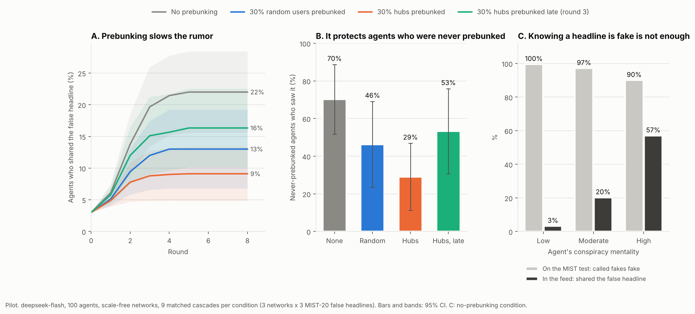

# Prebunking in LLM Agent Social Networks (pilot)

**Question.** In a social network of LLM agents, can psychological inoculation ("prebunking") stop a false headline from spreading, and does it matter *who* is prebunked and *when*?

**Why it matters.** LLM agent simulations (OASIS, MiroFish, POSIM) now reproduce how rumors spread online and are starting to be used to test interventions such as fact-checks, accuracy prompts and debunking. Prebunking is psychology's best-supported defense against misinformation in humans. Rule-based network models (Pilditch, Roozenbeek, Madsen & van der Linden, 2022) predict herd-immunity effects when the right users are inoculated before beliefs consolidate, and RumorSphere (Liu et al., 2025) reports that pre-bunking flattens the rumor curve in a hybrid simulation where most agents follow fixed rules. Neither tests *who* should be prebunked, *when*, and whether never-prebunked agents are protected, with agents that all read the actual message. This pilot does.

## Related work

- **Gao Mengjiao & Wu Shufang (2026)**, 基于靶向人群干预的网络谣言传播控制及智能体仿真研究, *图书情报工作* (online first 2026-09-15): C-SINCR model plus 40 GPT-4 agents, with interventions targeted at user types. We target psychological inoculation by network position and timing, with matched replications, and measure protection of never-prebunked agents.
- **Li, Xu, Zhang & Malthouse (2024)**, LLM-driven multi-agent simulation for news diffusion under different network structures, arXiv:2410.13909: blocks influential agents and announces accuracy; no inoculation.
- **Liu et al. (2025)**, RumorSphere, arXiv:2509.02172: hybrid LLM and rule-based agents; pre-bunking flattens the rumor curve; no targeting, coverage or indirect-protection analysis. Here every agent is an LLM reading the message.
- **Ma Yanfang, Liu Danyang, Li Zhen & Li Zongmin (2025)**, SEICR rumor model with bidirectional spreader conversion, *系统科学与数学*: equation-based, no agents reading the message.
- **Han Jiayan & Cao Lianying (2026)**, SICMR model with official debunking, *海南师范大学学报(自然科学版)* 39(2): equation-based, and tests debunking rather than prebunking.
- **Zhou Xiaoli (2025)**, Zhengzhou University master's thesis: rule-based agent model with intentional rumor spreaders and debunking timing; we vary prebunking timing with LLM agents.
- **Pilditch et al. (2022)** and **Yang & Cao (2025)**: herd immunity with rule-based agents; we test whether the same indirect protection appears when agents are LLMs.

## Results (pilot, DeepSeek `deepseek-flash`, 100 agents)



Each condition was run on the same 9 cascades (3 networks x 3 false headlines, same seed users), so conditions are compared pairwise. Effects are Hodges-Lehmann estimates of the paired difference with a paired bootstrap 95% CI (10,000 resamples). p values are Wilcoxon signed-rank, with Holm-adjusted p across the five reach tests and, separately, across the three indirect-protection tests of each definition. One cascade (network 1, headline F) never spread beyond its seed users in any condition. Wilcoxon drops zero differences, so the reach tests against no prebunking rest on 8 cascades (fewer for the head-to-head comparisons, where more cascades tie).

| Finding | Evidence |
|---|---|
| Prebunking the 30% best-connected agents before the rumor appeared cut its reach from **22% to 9%** of agents (-59%) | -12.5 points, 95% CI [-20.0, -7.0], lower in 8/9 cascades, Wilcoxon p = .008, Holm p = .039 |
| Prebunking 30% random agents: reach fell to 13% on average (-41%), but this **does not survive correction** for multiple tests | -9.0 points, 95% CI [-15.0, -1.5], lower in 7/9, p = .039, Holm p = .078 |
| **Timing matters:** prebunking the same hubs from round 3, after the rumor started, cut reach only to 16% | late minus early +8.0 points, 95% CI [+1.0, +11.5], early never worse (better in 7/9, tied in 2), p = .016, Holm p = .047. Late hubs vs none: -5.0 points [-10.0, -2.0], Holm p = .039 |
| **Indirect protection:** agents who were never prebunked saw the rumor far less often (70% without prebunking vs 29% with hubs prebunked) | -42.4 points, 95% CI [-66.6, -16.8], lower in 9/9 cascades, p = .004, Holm p = .012. Late hubs: -10.5 points [-39.7, -6.7], Holm p = .012. Random: -26.0 points [-42.9, -2.0], p = .055, not significant. These headline numbers count all never-prebunked, non-seed agents in each condition, so the no-prebunking baseline includes the hubs. Counting only the same agents in every condition (those outside both the hub and the random set) is stricter: 65% vs 30%, -37.1 points [-59.5, -13.3], lower in 8/9, Holm p = .023; late hubs -7.8 points [-36.6, -3.1], Holm p = .023; random -27.4 points [-41.7, -2.1], Holm p = .039, so random prebunking does reach significance under this definition. Once exposed, the same agents (non-seed, outside the hub set) shared at a similar rate in both conditions (16% vs 15% of decisions), so the protection came mainly from not being reached |
| Prebunked agents shared less once exposed | 10.4% of decisions by agents prebunked at the time vs 18.8% by agents who were not (all four conditions pooled). Descriptive only: these pool decisions from different agents, and 81% of the prebunked decisions are by hubs. Many explicitly cite "the conspiracy framing the video warned about" |
| **Knowing is not doing:** agents with high conspiracy mentality who scored a perfect 20/20 on the MIST still shared the false headline 47.5% of the time once exposed (low conspiracy mentality, also 20/20: 3%) | 17 agents, 120 decisions; 11 of 17 shared at least once. Higher MIST scores still predict less sharing: OR 0.47 per MIST point, 95% CI [0.29, 0.76], p = .002 (GEE logistic, agent clusters); OR 0.50, p = .045 with conspiracy mentality as covariate. But 85 of 100 agents scored 20/20, so this link rests on the 15 agents who missed at least one item (8 of them high in conspiracy mentality) |
| Hubs vs random prebunking | Suggestive only: -3.5 points, 95% CI [-7.0, 0.0], lower in 5/9 (4 tied), p = .062, Holm p = .078. Underpowered, not a null: with 5 untied cascades, .062 is the smallest p the test can give |

Full tables: [`results/pilot/summary.md`](results/pilot/summary.md).

## What did not work, and what it means

- **Out of the box, agents almost never spread misinformation.** In a first smoke test agents shared the false headline 7% of the time and it died after the seed users. Adding three news-psychology traits to the personas (conspiracy mentality, intuitive vs analytic thinking, sharing without reading) fixed this: in the full pilot, agents in the no-prebunking condition shared the false headline in 20% of decisions, with the gradient human studies predict (low 3%, moderate 20%, high 57% conspiracy mentality). The traits were added once, after that smoke test, and are reported as part of the method.
- **The MIST-20 is at ceiling for LLM agents:** 96% of fakes spotted and 100% of real headlines accepted, against 66% and 69% for 1,516 U.S. adults (YouGov, 2023). The items have been public since 2023 and are likely in training data. LLM-based social simulations therefore risk underestimating misinformation spread unless agents are calibrated against human data.
- **True headlines barely spread in any condition** (3-4% of agents on average, close to the 3% who seeded them), even though agents believed them more than the false ones (5.2 vs 3.4 on a 7-point scale). This mirrors the finding that false news travels farther than true news (Vosoughi, Roy & Aral, 2018), but it means this pilot cannot test whether prebunking makes agents reject true news.

## Design

| Part | Choice |
|---|---|
| Agents | 100 U.S. social media users: age, education, occupation, politics, media trust, Big Five, plus conspiracy mentality, intuitive vs analytic thinking, and sharing habit |
| Network | Scale-free network with clustering (Holme-Kim, m = 3, p = 0.3), so hubs exist; 3 different networks |
| Headlines | MIST-20 items: false A, C, F and true K, M, O; each spreads separately from 3 non-hub seed users |
| Spread rule | Each round, an agent whose friends newly shared the headline rates its accuracy (1-7) and decides whether to share; it may reconsider up to 3 times as more friends share; 8 rounds |
| Conditions | No prebunking · 30% random users prebunked · 30% hubs prebunked · 30% hubs prebunked late (from round 3) |
| Prebunk | Technique-based inoculation (conspiracy framing, fake science, us-versus-them outrage): forewarning plus a weakened example of each, none repeating a MIST claim |
| Measures | Final reach; exposure and sharing of never-prebunked agents; share rate once exposed; MIST-20 taken plain and after the prebunk, compared with YouGov human data |

## Run it

Windows: `python -m venv .venv`, `.venv\Scripts\activate`, `set LLM_API_KEY=sk-...`
Mac/Linux: `python3 -m venv .venv && source .venv/bin/activate`, `export LLM_API_KEY="sk-..."`

```
pip install -r requirements.txt
python run_pilot.py --backend mock --run mock_test        # free pipeline test, fake numbers
python run_pilot.py --backend openai --run calib --calibrate   # MIST-20 only: agents vs humans
python run_pilot.py --backend openai --run pilot          # full pilot (~3,000 calls, a few minutes)
python analyze.py --run pilot                             # figure + summary
```

The script checks the key and model before spending anything, runs DeepSeek in non-thinking mode, and caches every call so interrupted runs resume for free. Other providers: `--base-url` and `--model` (any OpenAI-compatible API).

## Limits of this pilot

One model, 100 agents, 3 networks, 3 false headlines that the model has probably seen, one prebunk text, English only. The 9 cascades are not independent: the 3 headlines on each network share its agents and graph, and the cascade-level tests treat them as if they were independent. Three networks are too few for a network-level test; as a direction check, averaging the headlines within each network, every comparison points the same way in all 3 networks. The prebunk sits in the prebunked agents' instructions, so their own lower sharing is partly instruction following; the indirect protection of never-prebunked agents is a network effect and does not have that problem. Agent behavior is simulated, so results describe LLM agent societies; how closely they track people is measured, not assumed.

## Next steps for the thesis

Move to OASIS; use Chinese Weibo rumors and fresh items the model cannot have memorized; compare several models (DeepSeek, Qwen, GLM, Llama); vary prebunk coverage from 0% to 50% to locate the threshold at which spread stops; test harm to true news with more shareable true headlines; compare the LLM-agent results with the predictions of rule-based inoculation models.

## Sources

- Maertens et al., The Misinformation Susceptibility Test (MIST), *Behavior Research Methods*.
- YouGov, Misinformation Susceptibility poll, April 3-9, 2023, 1,516 U.S. adult citizens.
- Pilditch, Roozenbeek, Madsen & van der Linden (2022), Psychological inoculation can reduce susceptibility to misinformation in large rational agent networks, *Royal Society Open Science*.
- Vosoughi, Roy & Aral (2018), The spread of true and false news online, *Science*.
- OASIS: Open Agent Social Interaction Simulations with One Million Agents (CAMEL-AI, 2024), arXiv:2411.11581.
- Liu et al. (2025), RumorSphere: A Framework for Million-scale Agent-based Dynamic Simulation of Rumor Propagation, arXiv:2509.02172.
- Liu et al. (2024), From Skepticism to Acceptance: Simulating the Attitude Dynamics Toward Fake News, IJCAI 2024 (debunking timing with LLM agents).
- Persona traits: Bruder et al. (2013) conspiracy mentality; Pennycook & Rand (2019) analytic thinking and misinformation; Gabielkov et al. (2016) sharing without reading.
